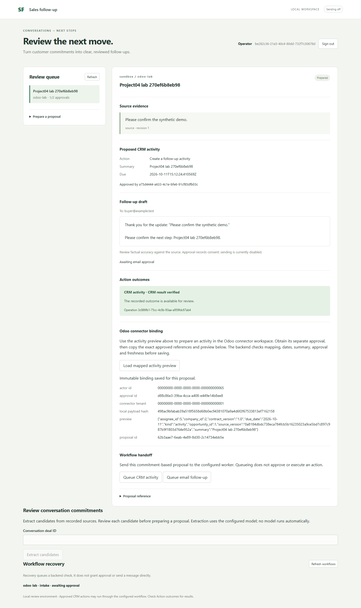
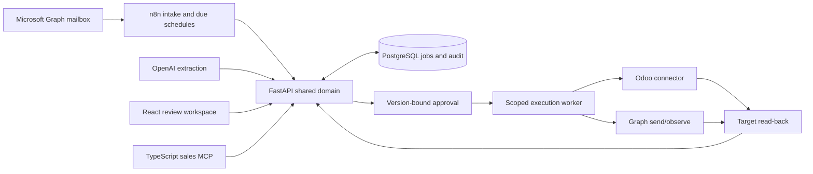

# AI Sales Follow-up & CRM Automation

[](https://github.com/williamlo90/ai-sales-followup-crm-automation/actions/workflows/ci.yml)

A customer email becomes a source-backed CRM activity and a reviewable follow-up draft. A salesperson checks the evidence and proposed change; a separate approver authorizes the exact action. The system verifies the Odoo result and records uncertain outcomes for recovery.

[See the synthetic sales walkthrough](docs/phase-8/DEMO.md) · [Operator guide](docs/phase-8/OPERATOR-GUIDE.md) · [MCP tools](mcp-server/README.md) · [Documentation](docs/README.md)



The screenshot is an automated browser run with synthetic data against the local app, PostgreSQL and Odoo sandbox. It shows a verified CRM activity; email approval remains separate and sending is off. [Browser evidence](docs/evidence/phase-7-connected-browser.json).

## Why this project

After a customer conversation, sales teams must find the right deal, capture changed commitments, schedule the next action and write a follow-up. A wrong account, unsupported promise or duplicate email can cost more than the automation saves.

This project keeps AI suggestions separate from authority. Python owns tenant scope, source freshness, version-bound approval, idempotency and the operation ledger. n8n schedules intake and due work through that shared domain. A React workspace shows the quote, CRM diff, draft, approval and recovery state. A TypeScript MCP server exposes bounded tools without copying business rules.

## Validated results

| Area | Local sandbox result | Evidence |
| --- | --- | --- |
| Connected journey | One synthetic Outlook message traversed Graph, n8n, OpenAI, the shared API/PostgreSQL and Odoo; one approved CRM operation was verified by read-back. Separate automated lab identities handled review and approval. No email was sent in this journey. | [Connected run](docs/evidence/phase-7-connected-email-ai-odoo.json), [draft read-back](docs/evidence/phase-7-connected-draft.json) |
| AI regression | Correct deal linkage and proposal count/recipient in 20/20 frozen synthetic cases; 19/19 invoked extractions correct. This reused a prior held-out set and does not establish generalization to customers. | [Evaluation](docs/evidence/phase-7-postgres-openai-quality.json) |
| Workflow and recovery | Both three-minute n8n schedules fired in an isolated engine. A queued job survived an accelerated missed-schedule drill and reached one verified Odoo effect. An uncertain Graph operation was reconciled by observing Sent Items with zero new dispatches. | [Schedules](docs/evidence/phase-7-n8n-three-minute-trigger.json), [catch-up](docs/evidence/phase-7-missed-schedule-recovery.json), [reconciliation](docs/evidence/phase-7-graph-unknown-reconciliation.json) |
| Local delivery | A clean extraction passed 332 Python tests, UI/MCP builds, two MCP reference-client tests and an inactive import of both workflows into pinned n8n. | [Delivery audit](docs/phase-8/DELIVERY-AUDIT.md), [release check](docs/evidence/phase-8-release.json) |

Controlled synthetic email sends were tested separately with user authorization. An accepted Graph request or Sent Items record is not proof that a recipient read the message. Workload samples are small and exclude Graph/model latency; they are not production capacity claims. See the [case study](docs/CASE-STUDY.md) and [Phase 7 audit](docs/phase-7/COMPLETION-AUDIT.md) for denominators and limits.

## Sales journey

1. **Read and match.** Graph reads an authorized sandbox mailbox; a configured mapping binds the message to the permitted deal.
2. **Extract and prepare.** The model proposes source-backed commitments. The shared domain checks date, revision and account context, then prepares a CRM diff and follow-up draft.
3. **Review and approve.** The operator inspects the source and recipient. A different approver approves the exact CRM or email payload; either action can remain blocked independently.
4. **Execute and verify.** A scoped worker uses the operation ledger before writing. Odoo is read back; uncertain Graph/Odoo results are observed before retry.
5. **Recover.** Durable jobs, checkpoints and explicit review states let an operator handle restarts or changed source without blind resend.

## Architecture



Four reusable application skills—commitment extraction, CRM preparation, follow-up drafting and reconciliation—share the same Python implementation across the UI/API, MCP and n8n callers. [Skill contracts](REUSABLE-SKILLS.md).

**Stack:** Python 3.13, FastAPI, PostgreSQL 17, React/TypeScript, Node.js 22, MCP, n8n, Microsoft Graph, Odoo sandbox and OpenAI. The PostgreSQL container was capped at 256 MiB in local acceptance. Claude/Grok adapters exist without live API validation; a tested local Qwen3 profile did not pass the quality gate.

## Try the offline review workspace

The synthetic SQLite demo needs no Docker, mailbox, Odoo account or model API key. It does not perform external writes.

```powershell
python -m venv .venv
.venv/Scripts/python.exe -m pip install -r backend/requirements.lock
npm.cmd ci --prefix web
.venv/Scripts/python.exe -m scripts.seed_demo
$env:SALES_IDENTITIES_PATH = 'local/identities.json'
.venv/Scripts/python.exe -m uvicorn backend.app:from_environment --factory --host 127.0.0.1 --port 8040
```

In another terminal, run `npm.cmd run dev --prefix web` and open http://127.0.0.1:8044. The seed creates private role tokens in ignored `local/access-tokens.json`; use the operator and approver roles separately. For Linux/macOS, use `.venv/bin/python` and `npm` instead. Run `.venv/Scripts/python.exe -m pytest -q` and `npm.cmd run build --prefix web` for offline checks. For MCP checks, run `npm.cmd ci --prefix mcp-server`, then its build and test scripts.

Connected setup requires project-specific credentials, sandbox mappings, PostgreSQL and inactive n8n workflow import. Follow the [operator guide](docs/phase-8/OPERATOR-GUIDE.md); never commit `.env`, tokens or database state. The exported workflows are in [`automation/n8n/`](automation/n8n/README.md).

## Delivery scope

This is a **local-delivered, connected-sandbox-validated** V1. It is not an internet-facing production service or a 24-hour scheduler: a sleeping laptop stops the workflows until the stack returns. The owner selected local V1 and did not select cloud hosting or Make.com/Zapier variants for Phase 9. [Decision record](docs/phase-9/DECISION.md).

[Security and disclosure](SECURITY.md) · [Phase plan](PHASES.md) · [Delivery evidence](docs/phase-8/DELIVERY-AUDIT.md)
